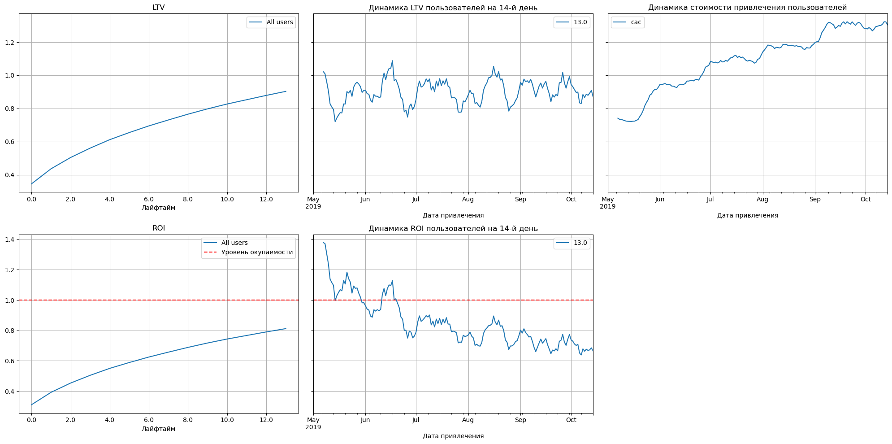
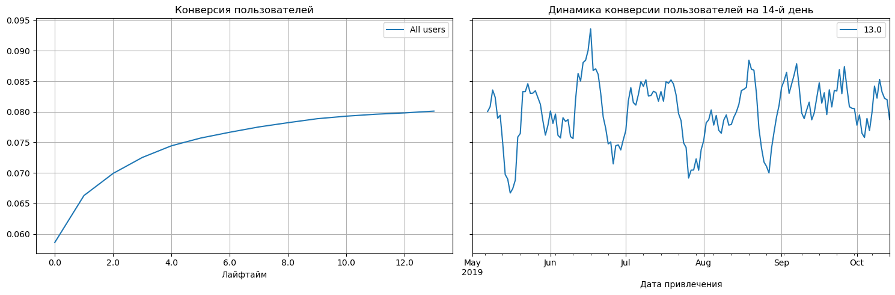
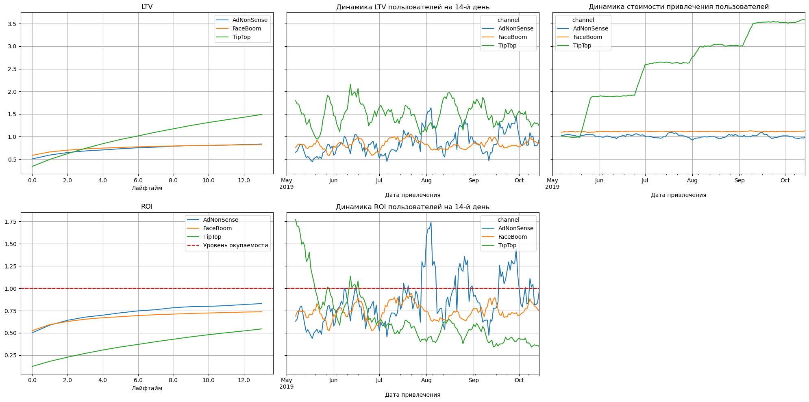

# Анализ юнит-экономики и окупаемости рекламы Procrastinate Pro+

**Маркетинговая и продуктовая аналитика · Python · Pandas · Когортный анализ**

## О проекте

Procrastinate Pro+ — развлекательное приложение, которое привлекает пользователей через несколько рекламных каналов. Несмотря на маркетинговые расходы, приложение не достигает целевой окупаемости.

**Бизнес-задача:** выяснить, какие факторы мешают окупаемости рекламных вложений, оценить качество привлечённой аудитории и предложить меры по повышению эффективности маркетинга.

В исследовании используются данные о пользовательских сессиях, покупках и расходах на рекламу. Показатели рассматриваются в разрезе **страны, устройства и канала привлечения**, в том числе с помощью когортного анализа.

## Стек

- **Python:** `pandas`, `numpy`;
- **Визуализация:** `matplotlib`, `seaborn`;
- **Среда:** Jupyter Notebook;
- **Методы:** подготовка данных, группировки и сводные таблицы, когортный анализ, анализ динамики и сегментация пользователей.

## Что сделано

1. **Подготовлены данные:** загружены три набора данных, проверены пропуски и дубликаты, приведены типы дат и названия столбцов.
2. **Сформированы профили пользователей:** определены дата и канал первого визита, страна, устройство, факт покупки и стоимость привлечения.
3. **Рассчитаны маркетинговые и продуктовые метрики:** LTV, CAC, окупаемость привлечения, конверсия и удержание пользователей.
4. **Проведён когортный анализ:** метрики рассчитаны для горизонта **14 дней** с учётом срока наблюдения за пользователями.
5. **Исследованы сегменты:** сопоставлены результаты по странам, устройствам и рекламным каналам.
6. **Подготовлены рекомендации:** выявлены неэффективные направления расходов и возможные точки роста.

## Ключевые метрики

| Метрика | Что показывает |
|---|---|
| **CAC** | Средние расходы на привлечение одного пользователя |
| **LTV** | Накопленная выручка на пользователя за выбранный горизонт |
| **ROI (LTV / CAC)** | Коэффициент окупаемости привлечения; значение **1** соответствует порогу окупаемости |
| **Conversion Rate** | Доля пользователей, совершивших первую покупку |
| **Retention Rate** | Доля пользователей, вернувшихся в приложение на соответствующий день |

> **Примечание:** в коде показатель `ROI` вычисляется именно как **LTV / CAC**, а не по классической формуле доходности инвестиций `(доход − затраты) / затраты`. Поэтому для данного проекта порог окупаемости равен **1**.

## Основные результаты

- **Суммарные расходы на рекламу — около $105,5 тыс.** Наиболее значительные расходы приходятся на каналы **TipTop** и **FaceBoom**.
- **Платный трафик не достиг порога окупаемости** за установленный 14-дневный горизонт. Рост стоимости привлечения стал одним из основных факторов ухудшения показателя.
- **Конверсия привлечённых пользователей — около 8%**. При этом высокая конверсия отдельного сегмента не обязательно означает его высокую окупаемость.
- **США:** пользователи показывают сравнительно высокую конверсию, но рост CAC и слабое удержание ухудшают экономику привлечения.
- **Каналы AdNonSense, FaceBoom и TipTop** по результатам анализа находятся ниже порога окупаемости; у причин есть различия по стоимости привлечения и LTV.
- **Удержание неплатящих пользователей** на анализируемом горизонте близко к нулю, что указывает на проблему с возвратом аудитории.

### Динамика LTV, CAC и окупаемости



### Конверсия пользователей



### Каналы с окупаемостью ниже целевого уровня



## Рекомендации для бизнеса

1. **Пересмотреть распределение рекламного бюджета:** сократить расходы на каналы с низкой окупаемостью и отдельно проверить возможность масштабирования эффективных направлений, включая MediaTornado и YRabbit.
2. **Проверить потенциал географических сегментов:** рассмотреть увеличение привлечения во Франции, Великобритании и Германии с учётом их экономики.
3. **Исследовать удержание в США:** высокая конверсия при низком удержании требует анализа причин оттока и качества привлекаемой аудитории.
4. **Проверить способы повышения конверсии PC-пользователей**, сохраняя контроль окупаемости этого сегмента.

Рекомендации сформулированы по итогам исследовательского анализа; их эффект требует отдельной проверки на новых данных или в эксперименте.

## Данные

В проекте используются три CSV-файла:

| Файл | Содержание | Источник |
|---|---|---|
| `visits_info_short.csv` | Сессии пользователей, страны, устройства и источники привлечения | [Скачать](https://code.s3.yandex.net/datasets/visits_info_short.csv) |
| `orders_info_short.csv` | Покупки пользователей и выручка | [Скачать](https://code.s3.yandex.net/datasets/orders_info_short.csv) |
| `costs_info_short.csv` | Расходы на рекламу по датам и каналам | [Скачать](https://code.s3.yandex.net/datasets/costs_info_short.csv) |

В архив проекта данные не включены. Для воспроизведения анализа загрузите файлы по ссылкам выше.

## Как запустить

**1.** Скачайте репозиторий и откройте его в терминале.

**2.** Установите зависимости (желательно в виртуальном окружении):

```bash
python -m pip install -r requirements.txt
```

**3.** Создайте папку `datasets/` рядом с ноутбуком и поместите в неё три CSV-файла из раздела «Данные».

**4.** Запустите Jupyter Notebook:

```bash
jupyter notebook unit_economic.ipynb
```

**5.** Выполните ячейки по порядку. Код ноутбука читает данные по относительным путям вида `datasets/visits_info_short.csv`, поэтому запускать его нужно из корня проекта.

## Структура репозитория

```text
unit-economics-analysis/
├── README.md
├── unit_economic.ipynb
├── requirements.txt
├── assets/
│   ├── ltv_roi_overview.png
│   ├── conversion_overview.png
│   └── unprofitable_channels.png
└── datasets/                  # скачать отдельно, в архив не включены
    ├── visits_info_short.csv
    ├── orders_info_short.csv
    └── costs_info_short.csv
```

## Что демонстрирует проект

- Умение превращать бизнес-вопрос об эффективности маркетинга в систему измеримых метрик.
- Навыки очистки, объединения и агрегации данных в Python.
- Опыт построения пользовательских профилей и расчёта когортных показателей.
- Способность сравнивать сегменты, анализировать динамику и находить причины отклонений.
- Умение представлять результаты анализа через графики и конкретные рекомендации.

**Полный код и расчёты:** [`unit_economic.ipynb`](unit_economic.ipynb).
