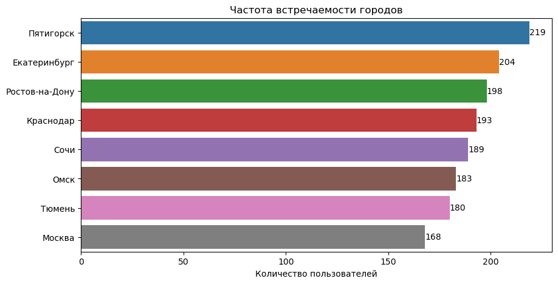
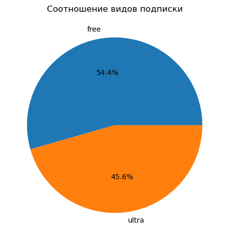
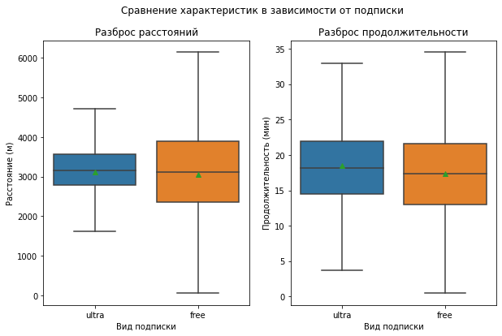
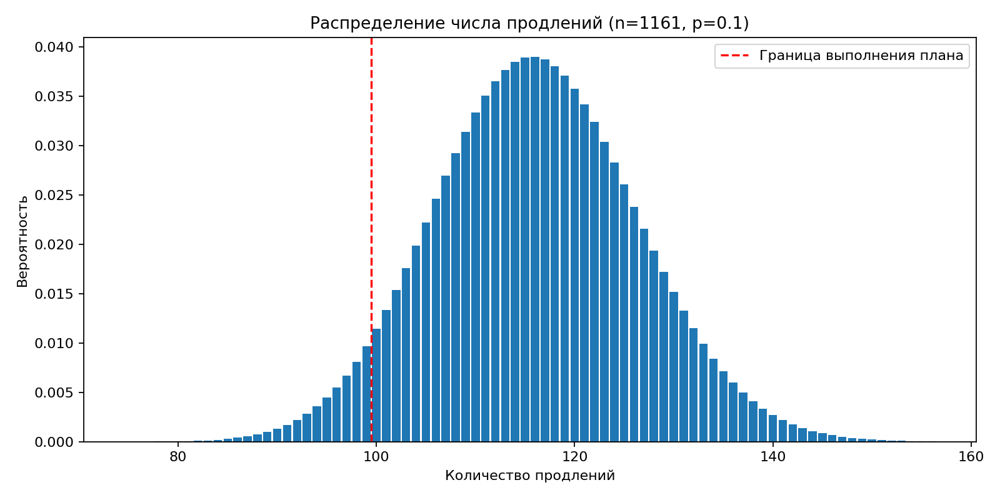

# Анализ поведения пользователей сервиса аренды самокатов GoFast

**Проект по продуктовой аналитике:** исследование поездок, сравнение подписных и бесплатных пользователей, расчёт выручки и оценка маркетинговых инициатив с помощью статистики.

## Задача

Команде сервиса аренды самокатов необходимо лучше понять поведение пользователей и оценить экономический потенциал подписки. В исследовании рассматриваются:

- распределение пользователей по городам и типам подписки;
- продолжительность и расстояние поездок;
- выручка по пользователям и месяцам;
- статистические гипотезы о различиях между подписными и бесплатными поездками;
- эффективность механики промокодов и вероятность отклика на push-уведомления.

## Инструменты

`Python` · `pandas` · `NumPy` · `SciPy` · `Matplotlib` · `Seaborn` · `Jupyter Notebook`

## Данные

Используются три таблицы:

| Файл | Что содержит |
|---|---|
| `users_go.csv` | Идентификатор, город, возраст и тип подписки пользователя |
| `rides_go.csv` | Продолжительность, дистанция и дата поездки |
| `subscriptions_go.csv` | Стоимость минуты, старта поездки и подписки |

В предоставленном ноутбуке исследуются **18 068 поездок** и **1 534 уникальных пользователя** после удаления 31 дубликата из таблицы пользователей. Исходные CSV-файлы **не включены** в этот репозиторий: для повторного запуска их нужно поместить в `datasets/`.

## Ход исследования

1. Загрузка, проверка типов данных, пропусков и дубликатов.
2. Исследовательский анализ: география пользователей, возраст, дистанции и длительность поездок.
3. Объединение таблиц и сравнение поездок с подпиской `ultra` и без неё (`free`).
4. Расчёт помесячной выручки на пользователя на основе длительности, числа поездок и тарифов.
5. Проверка статистических гипотез о расстоянии поездок и выручке с помощью t-тестов.
6. Оценка необходимого охвата промоакции биномиальной моделью; оценка открытий push-уведомлений с нормальной аппроксимацией.

## Ключевые результаты

- **45,6%** пользователей в исследуемой выборке имеют подписку `ultra`.
- Средний возраст пользователя — около **25 лет**.
- Средняя поездка — около **3,07 км** и **17,8 минуты**.
- Проверка гипотезы о среднем расстоянии **более 3 130 м** среди подписчиков не дала оснований отвергнуть нулевую гипотезу (`p ≈ 0,920`). Это **не является доказательством**, что истинное среднее не превышает 3 130 м.
- В представленных расчётах средняя помесячная выручка на пользователя с подпиской статистически выше, чем без неё (`p ≈ 1,89 × 10⁻³¹`, односторонний t-тест).
- При исторической вероятности продления подписки **10%** для получения хотя бы 100 продлений с вероятностью не менее 95% нужно выдать **минимум 1 161 промокод**.
- Если из 1 млн push-уведомлений открывают в среднем 40%, вероятность не превысить **399 500 открытий** по нормальной аппроксимации — около **15%**.

> **Примечание по качеству анализа.** В первоначальной версии ноутбука использовалось условие `P(X ≤ 100) ≤ 0.05` и получалось 1 172 промокода. Поскольку цель — *не менее 100* продлений, невыполнение плана означает `X < 100`, то есть `P(X ≤ 99)`. В приложенной версии ноутбука это уточнено. Первый заявленный вывод о сравнении средней продолжительности поездок в исходнике не сопровождался отдельным кодом теста, поэтому он не представлен здесь как подтверждённый результат.

## Визуализации

**Пользователи по городам**



**Доли пользователей с подпиской и без неё**



**Дистанция и продолжительность поездок по тарифам**



**Сколько промокодов нужно отправить**



## Практическая ценность

Результаты исследования позволяют оценивать потенциальную выручку подписного сегмента, выбирать параметры промоакций и планировать охват коммуникаций на основе статистической модели. Для принятия коммерческих решений потребуются дополнительные данные об издержках, маркетинговых расходах и поведении пользователей во времени.

## Как запустить

1. Склонировать репозиторий или скачать папку проекта.
2. Поместить исходные CSV-файлы в каталог `datasets/`.
3. Установить зависимости:

   ```bash
   pip install -r requirements.txt
   ```

4. Запустить Jupyter Notebook из корня проекта:

   ```bash
   jupyter notebook st_analysis_scooter.ipynb
   ```

5. Выполнить ячейки последовательно (Kernel → Restart & Run All). Пути к данным относительные: `datasets/users_go.csv` и т. д.

## Структура репозитория

```text
scooter_analytics_portfolio/
├── README.md
├── st_analysis_scooter.ipynb
├── requirements.txt
├── FIXES.md
├── datasets/
│   └── README.md
└── assets/
    ├── users_by_city.png
    ├── subscription_share.png
    ├── rides_by_subscription.png
    ├── promocodes_distribution.png
    └── push_notifications_distribution.png
```

*Данные и выводы относятся к исследуемой выборке. Это учебный кейс, а не отчёт о фактических финансовых результатах действующей компании.*
